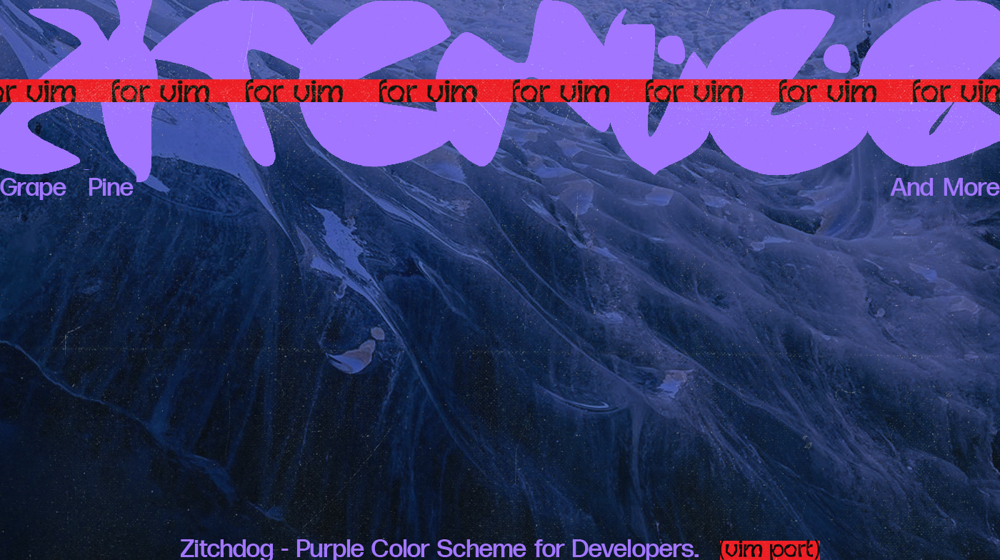
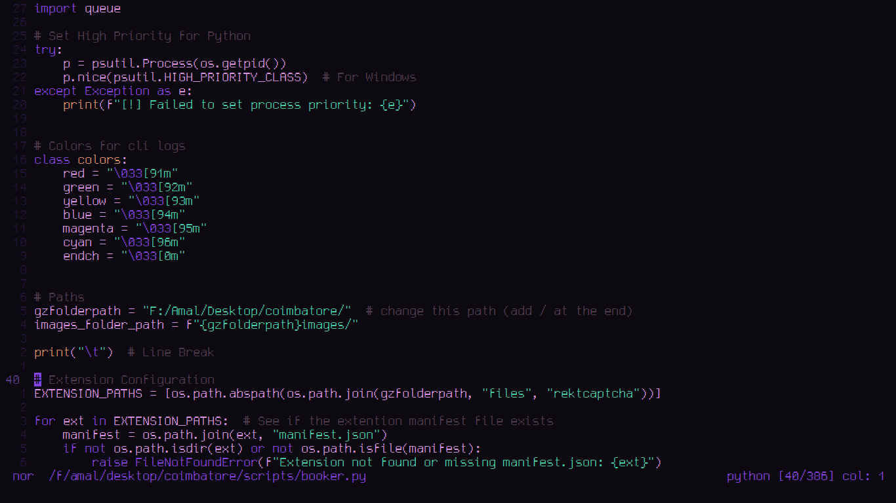
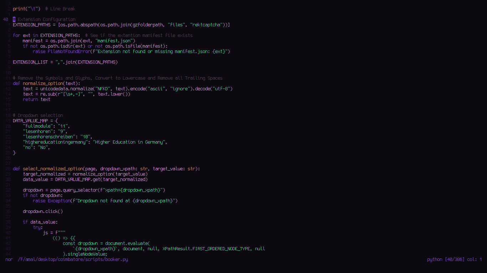

# Zitchdog.vim

A Vim port of the [theamallalgi/zitchdog](https://github.com/theamallalgi/zitchdog) color scheme for Neovim.  
Just like in Neovim, this vim-port comes in two variants: `grape` and `pine`.

> [!NOTE]
> This repository is generated automatically from the Neovim theme. Every change to [theamallalgi/zitchdog](https://github.com/theamallalgi/zitchdog) is converted and pushed here by a GitHub Action, and the files in `colors/` and `autoload/` are overwritten on each sync. We do not edit them by hand. To change a color or a highlight group, open an issue or pull request on the [Neovim repo](https://github.com/theamallalgi/zitchdog), but are there really anymore Vim users left?

## Installation

You can install this color scheme using your favorite Vim plugin manager.

#### Install using [vundlevim/vundle](https://github.com/vundlevim/vundle.vim)

```vim
Plugin 'theamallalgi/zitchdog.vim'
```

#### Install using [tpope/vim-pathogen](https://github.com/tpope/vim-pathogen)

```bash
git clone https://github.com/theamallalgi/zitchdog.vim.git ~/.vim/bundle/zitchdog.vim
```

#### Install using [junegunn/vim-plug](https://github.com/junegunn/vim-plug)

```vim
Plug 'theamallalgi/zitchdog.vim'
```

## Usage

To use the color scheme, add the following to your `.vimrc` file:

```vim
" Set the color scheme (defaults to grape)
colorscheme zitchdog
```

To select a variant, set the `g:zitchdog_style` variable before loading the color scheme. The available options are `grape` and `pine`.

```vim
" Choose a variant (e.g., 'pine')
let g:zitchdog_style = 'pine'

" Set the color scheme
colorscheme zitchdog
```

You can also load a variant directly:

```vim
colorscheme zitchdog-pine
```

## Options

Set these before loading the color scheme.

| Variable | Default | Description |
| --- | --- | --- |
| `g:zitchdog_style` | `'grape'` | Variant used by `colorscheme zitchdog`: `'grape'` or `'pine'` |
| `g:zitchdog_transparent_background` | `0` | Set to `1` to use your terminal background |
| `g:zitchdog_italic_comments` | `0` | Set to `1` to render comments in italics |

## Lightline

Matching lightline themes are included:

```vim
let g:lightline = { 'colorscheme': 'zitchdog_grape' }
" or
let g:lightline = { 'colorscheme': 'zitchdog_pine' }
```

## Screenshots




